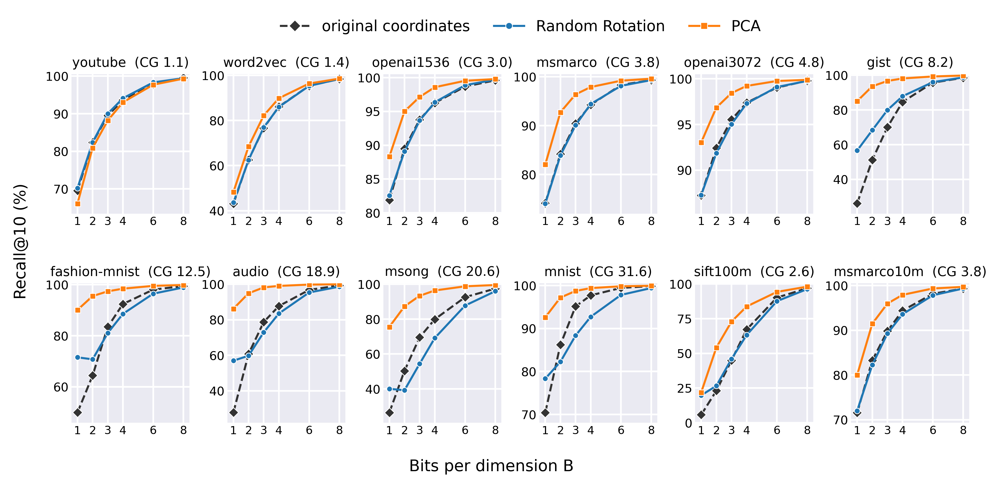

# PCA with Variance-Matched Bit Allocation vs. Random Rotation

Code, data recipes, and result files of the paper *[Experiment, Analysis, and Benchmark] PCA with Variance-Matched Bit Allocation
Outperforms Random Rotation in Approximate Nearest Neighbor Search* (Seolgyu Han and Sang-Won Lee, Seoul National University;
submitted to ICDE 2027).

The paper separates two decisions that recent quantization methods for ANN search bundle with an estimator, an index, and
re-ranking: the **basis** of the code and its **bit allocation**. The default pair is a random rotation with the same bits in every
dimension (*Random Rotation+α=0*). The paper compares it with PCA and bits matched to the component variances (*PCA+α=1*) under the
same scalar quantizer and the same bit budget, on thirteen datasets of up to 113 million vectors. High-rate quantization theory
applied to the L2 score error predicts the outcome, and the measurements agree. At a fixed bit budget the PCA pair has lower score
error and higher recall on every dataset except the one whose coding gain is close to 1, and on the ten datasets where re-ranking was
measured it needs fewer re-ranking candidates. Its lead grows with the coding gain.



## Two layers

| Layer | What you need | What it does | Time |
|---|---|---|---|
| **Results** | Python 3.9+, numpy, matplotlib | recomputes every number of the paper from `results/` and redraws the five figures, and checks both against the paper (`numbers/numbers.json`, `figures/published/`) | about a minute |
| **Experiments** | the datasets (`data/README.md`), scipy, threadpoolctl; for the large datasets a C++ compiler with OpenMP | reruns the measurements that produced `results/` | minutes (audio) to days (msmarco113m) |

```bash
pip install -r requirements.txt
bash reproduce.sh            # results layer: numbers + figures + checks -> "ALL CHECKS PASSED"
```

## Layout

```
pcafair/        the shared code: config.py (paths), engine.py (allocation, rotations), codec.py (the quantizer of both designs),
                bigsets.py (the same codec from streaming statistics), bigkern.py (C kernels of the large passes)
results/        the published result files (README.md lists every file and its columns)
numbers/        make_numbers.py recomputes every number printed in the paper; numbers.json holds them with their rule
figures/        fig1_recall.py ... fig5_slope.py (+ common.py, slope_curves.py); published/ holds the paper's PNG/PDF
experiments/    the measurement scripts (README.md: protocols, order, outputs); bigsets/ for the large datasets
data/           dataset recipes: download/convert, prepare.py (centering, PCA), gt_l2.py (exact L2 top-100), big_*.py
docs/           proofs.md (Lemma 1, Propositions 1 and 2 with the step to the score, the dither facts, the Haar deficit), quantizer.md (ranges, dither, gains)
tests/          check_results.py (results layer), parity_audio.sh + compare_dir.py (experiment layer, end to end on audio)
csrc/           bigkern.cpp, the top-k filtering kernels of the streaming passes (make -C csrc)
```

## Figures and tables of the paper

| In the paper | Script | Result files it reads |
|---|---|---|
| Fig. 1 (Recall@10 vs. bits, three arms, 12 datasets) | `figures/fig1_recall.py` | `results/fullscan/`, `results/bigsets/fullscan*/` |
| Fig. 2 (variance spectra and per-dimension score-error terms) | `figures/fig2_spectrum.py` | `results/spectra/`, `results/decomp*/` |
| Fig. 3 (score error vs. bits, B = 1–8) | `figures/fig3_score.py` | `results/score_error*/`, `results/bigsets/score_error*/` |
| Fig. 4 (Recall@10 after re-ranking the top W) | `figures/fig4_rerank.py` | `results/rerank/` |
| Fig. 5 (recall against the slope α, oracle slope) | `figures/fig5_slope.py` | `results/fullscan/` (pcaslope, pcafine), `results/bigsets/s7_slope.csv`, `fullscan_slope/` |
| Table III (datasets, coding gain) | `numbers/make_numbers.py` (`cg_*`) | `results/calc/exact_cg.json`, `results/bigsets/calc/` |
| Table IV (interval miss rates, recall change from dither) | `numbers/make_numbers.py` (`guar_miss_*`, `adv_*_drecall`) | `results/guarantee/`, `results/fullscan/` |
| every number in the text | `numbers/make_numbers.py` | listed per key in `numbers/numbers.json` (`src`) |

## Rerunning the experiments

1. Prepare the datasets (`data/README.md`): raw `.fvecs` → `data/prepare.py` → `data/gt_l2.py`. Set `PCARR_RAW` and `PCARR_PREPARED` (defaults
   `data/raw`, `data/prepared`); outputs go under `PCARR_WORK` (default `work/`).
2. End-to-end check on the smallest dataset: `bash tests/parity_audio.sh` (fits the codecs, runs every experiment on audio, compares
   with `results/`).
3. The ten datasets: `experiments/README.md`, steps 0–5. The frozen codecs are deterministic given the prepared data (training sample
   `numpy.random.default_rng(7)`); the ones of the paper are also attached to the GitHub release as `frozen_codecs.tar.gz`
   (39 codecs, 78 files, 479 MB; unpack into `$PCARR_FROZEN`).
4. The large datasets: `data/README.md` §3 for the raw files, then `make -C csrc` and `bash experiments/bigsets/run_big.sh`.

## The design in a few sentences

Both designs keep the norm of each prepared (centered) vector unquantized, in float64 in the code and as a 32-bit float in the paper's design, and quantize its direction u = x/‖x‖, one uniform scalar quantizer per component
(`docs/quantizer.md`). The cells of a component cover a range chosen among quantile candidates of a training sample. Components with
at least 2 bits use shared subtractive dither with a fixed gain; 1-bit components use a gain-corrected split; components without bits
are set to their mean. Random Rotation+α=0 rotates by a dense Haar matrix and gives every component B bits. PCA+α=1 uses the PCA basis
of u and gives component i `max(0, log2 σ_i² + c)` bits: Lemma 1 shows that the optimal allocation for the score error has slope 1 in
log2 σ², twice the slope of the reconstruction-error allocation. The score of a candidate is ‖x‖² − 2‖x‖⟨q̃, û⟩. Recall@10 is measured
against the exact L2 top-10 with a full scan, and re-ranking re-scores the top W candidates with the original vectors.

## Citation and license

`CITATION.cff` has the citation entry. The code and the result files are released under the Apache License 2.0 (`LICENSE`, `NOTICE`);
the datasets keep their own licenses and are not redistributed here. A GitHub Actions workflow (`.github/workflows/reproduce.yml`) runs
`reproduce.sh` on every push.
